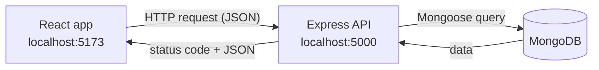
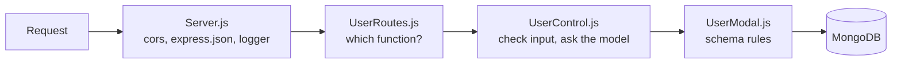
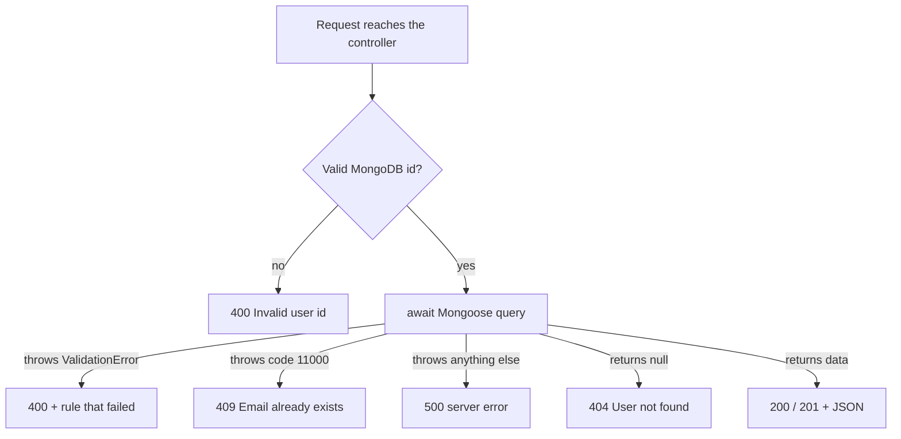

<h1 align="center">User Manager</h1>

<p align="center">
  A full-stack <b>MERN CRUD</b> app to add, view, edit and delete users,<br/>
  with clear error handling on both the backend and the frontend.
</p>

<p align="center">
  
  
  
  
</p>

<p align="center">
  
</p>

---

## About the project

I built this project to learn how the four parts of the MERN stack work together. The React frontend shows a form and a table. The Express API receives requests, checks the data and talks to MongoDB through Mongoose. Every user has a **name, email, gender, mobile number and status**.

I also spent time on what happens when things **go wrong**: missing fields, duplicate emails, wrong IDs, users that don't exist, the database being down, and the backend not running. Each case returns the right HTTP status code and a message the user can actually understand.

## Features

| | Feature | How it works |
|---|---|---|
| **C** | Create a user | Fill in the form and click **Add User** |
| **R** | Read all users | The table loads automatically when the page opens |
| **U** | Update a user | Click **Edit**, the form fills with that user's data, change it, click **Edit User** |
| **D** | Delete a user | Click **Delete** and confirm |
| ⚠ | Error messages | Problems show in a red box at the top, which you can close with **x** |

## Tech stack

| Layer | Technology | Job |
|---|---|---|
| Frontend | React (Vite), Axios, CSS | Form, table and error messages |
| Backend | Node.js, Express | REST API, input checks, error responses |
| Database | MongoDB, Mongoose | Stores users; schema rules such as required and unique |
| Tools | dotenv, cors, nodemon | Settings in `.env`, cross-origin access, auto-restart |

## How it works



Inside the backend, each request passes through these files in order:



## Project structure

```
User_Manager_portal/
├── BackEnd/
│   ├── Db.js                      # connects to MongoDB
│   ├── Server.js                  # Express setup, 404 and error handler
│   ├── modal/UserModal.js         # user schema and validation rules
│   ├── controller/UserControl.js  # CRUD logic and error responses
│   └── routes/UserRoutes.js       # URL → controller function
└── FrontEnd/
    └── React/
        └── src/
            ├── api.js             # axios setup and getErrorMessage()
            ├── App.jsx            # state, API calls, error box
            ├── UserForm.jsx       # add / edit form
            └── UserTable.jsx      # list of users
```

## API endpoints

| Method | Endpoint | Body | Success | Possible errors |
|---|---|---|---|---|
| `GET` | `/api/users` | – | `200` list of users | `500` |
| `GET` | `/api/users/:id` | – | `200` one user | `400` `404` `500` |
| `POST` | `/api/users` | user JSON | `201` new user | `400` `409` |
| `PUT` | `/api/users/:id` | fields to change | `200` updated user | `400` `404` `409` |
| `DELETE` | `/api/users/:id` | – | `200` `{ message: "User deleted" }` | `400` `404` `500` |

Example body for `POST /api/users`:

```json
{
  "name": "Asha",
  "email": "asha@example.com",
  "gender": "Female",
  "mobileNumber": "+353 87 123 4567",
  "status": "Active"
}
```

---

## Error handling

Errors are handled in **three layers**, so every problem ends up as a clear message on the screen instead of a crash or a blank page.



### Layer 1: the database rules (Mongoose schema)

The schema is the first line of defence. If data breaks a rule, Mongoose refuses to save it and throws a `ValidationError`.

| Field | Rule | What the user sees if it breaks |
|---|---|---|
| `name` | required | `User validation failed: name: Name is required` |
| `email` | required, unique, saved in lowercase | `Email is required`, or `Email already exists` (409) |
| `gender` | one of Male, Female, Other (or empty) | `` `X` is not a valid enum value for path `gender` `` |
| `status` | Active or Inactive | `` `Maybe` is not a valid enum value `` |

`runValidators: true` is set on updates. Without it, Mongoose would only check these rules when creating a user, not when editing one.

### Layer 2: the controllers (`UserControl.js`)

Every controller function follows the same pattern: **check the input → run the database query inside `try` → handle a missing result → reply**. If anything inside `try` throws, `catch` decides the status code.

| Situation | How it's detected | Status | Message |
|---|---|---|---|
| ID isn't a valid MongoDB id (e.g. `/api/users/123`) | `mongoose.Types.ObjectId.isValid(id)` is false | **400** | Invalid user id |
| Required field missing or a rule broken | `ValidationError` thrown by Mongoose | **400** | The rule that failed |
| Email already used by another user | MongoDB error `code === 11000` | **409** | Email already exists |
| Valid ID, but no user with it | query returns `null` | **404** | User not found |
| Database down or an unexpected bug | anything else in `catch` | **500** | The error message |

Two details matter here:

- **`return` before every early reply.** Without it, the function would keep running and try to send a second response, which crashes the request with *"Cannot set headers after they are sent"*.
- **Only known fields are saved.** The controller copies just `name, email, gender, mobileNumber, status` out of `req.body`. Anything extra a client sends, such as `isAdmin: true`, is ignored. This prevents a problem called **mass assignment**.

### Layer 3: the safety nets in `Server.js`

| Safety net | When it runs | Reply |
|---|---|---|
| **404 handler** | No route matched the URL (e.g. `/api/userz`) | **404** `Route not found: /api/userz` |
| **Error handler** `(err, req, res, next)` | Something throws outside the controllers, e.g. broken JSON in the request body | **400 / 500** with a JSON message instead of an HTML error page |
| **Start-up check** | MongoDB can't be reached when the server starts | Prints `MongoDB connection failed` and stops, instead of running without a database |

### On the frontend (React)

- **One helper turns any error into readable text.** `getErrorMessage()` in `api.js` uses, in order:
  1. the server's own message, e.g. "Email already exists"
  2. Axios's message, e.g. "Network Error" when the backend isn't running
  3. a general fallback, "Something went wrong"
- **Every API call sits inside `try / catch`.** On failure, the message goes into the `error` state and shows in a **red box**, which closes with **x**.
- **The form only clears if the save really worked.** `saveUser` returns `true` or `false`, so if saving fails, the user's typing stays in the form and they can fix it.
- **The browser checks first.** `required` and `type="email"` stop obviously bad input before a request is even sent. The backend checks again anyway, because browser checks can be skipped (for example by using Postman).
- **Delete asks before it acts.** A confirmation prompt prevents accidental deletes.

### Every error, end to end

| What you do | Status | Message in the red box |
|---|---|---|
| Add a user with an email that already exists | 409 | Email already exists |
| Send a user with no name (e.g. from Postman) | 400 | User validation failed: name: Name is required |
| Edit or delete a user someone else just deleted | 404 | User not found |
| Use the app while the backend is stopped | – | Network Error |
| Use the app while MongoDB is stopped | 500 | (database error message) |

---

## Getting started

**You need:** Node.js 20+, and MongoDB running locally or a free MongoDB Atlas cluster.

```bash
# 1. Clone the project
git clone https://github.com/ravinbr23/User_Manager_portal.git
cd User_Manager_portal

# 2. Backend
cd BackEnd
npm install
# create a .env file with the values below
npm run dev          # API on http://localhost:5000

# 3. Frontend (in a second terminal)
cd FrontEnd/React
npm install
npm run dev          # app on http://localhost:5173
```

`.env` values:

```
PORT=5000
MONGO_URI=mongodb://127.0.0.1:27017/mydatabase
```

## Testing the API

I tested every endpoint in **Postman** before connecting the frontend, including the failure cases:

- ✅ Create, read, update and delete a user
- ✅ Duplicate email → 409
- ✅ Missing name → 400
- ✅ Invalid id (`/api/users/123`) → 400
- ✅ Valid but unknown id → 404
- ✅ Unknown route → 404
- ✅ Broken JSON body → 400

## What I learned

- How a request travels from React through Express and Mongoose to MongoDB, and back
- Structuring a backend with routes, controllers and models
- Choosing the right HTTP status code for each kind of error
- Managing state in React and showing server errors to the user

## Future improvements

- [ ] Login and sign up with JWT, so only logged-in users can manage records
- [ ] Search and pagination for long lists
- [ ] Mobile number format validation
- [ ] Deploy (MongoDB Atlas + Render + Vercel)

## Author

**Ravin**: [GitHub](https://github.com/ravinbr23)
